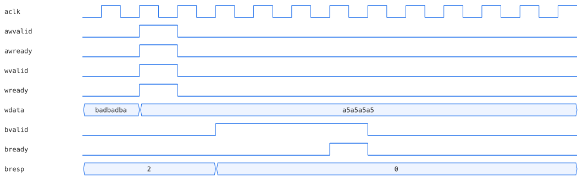
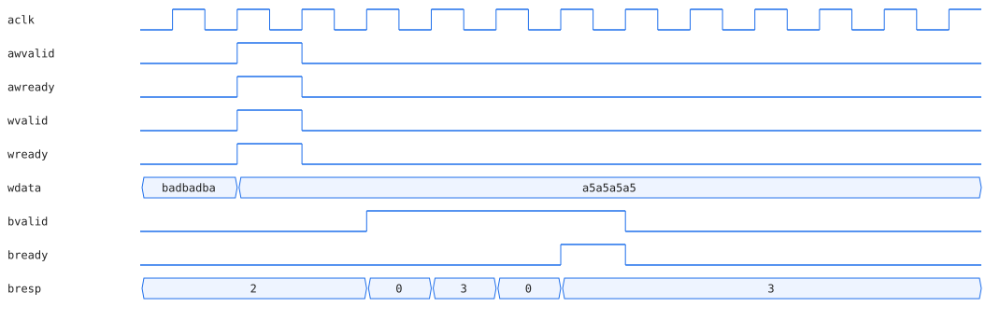

# AXI4-Lite 슬레이브 IP (Verilog)

ARM AMBA AXI4-Lite 규격을 따르는 32비트 레지스터 4개짜리 슬레이브를 RTL로 설계했습니다. 기능 테스트 13개와 별도로 프로토콜 규칙을 assertion으로 검사하고 일부러 버그를 넣어 두 검사 방식의 차이를 확인했습니다.

## 설계

| 주소 | 레지스터 |
|---|---|
| 0x00 ~ 0x0C | REG0 ~ REG3 (32비트 읽기/쓰기 · byte strobe 지원) |
| 그 밖 | SLVERR 응답 |

- **AW와 W 채널 분리.** 실제 AXI 마스터는 주소와 데이터를 다른 클럭에 어느 순서로든 보낼 수 있습니다. 두 채널을 각각 따로 받아 두었다가 둘 다 모이면 쓰기를 실행합니다.
- **backpressure.** 마스터가 BREADY/RREADY를 늦게 올려도 응답을 붙잡고 기다립니다.
- **assertion.** "VALID를 올린 뒤에는 READY 핸드셰이크가 끝날 때까지 VALID와 응답값을 바꾸면 안 된다"는 AXI 규칙을 RTL 안에서 매 클럭 검사합니다. 사용한 Icarus Verilog가 SVA concurrent assertion(`assert property`)을 해석하지 못해서 한 클럭 전 값을 저장해 두는 shadow register와 immediate assertion으로 같은 검사를 직접 구현했습니다.

## 기능 테스트

```
PASS [REG0 write resp]: resp 0
PASS [REG0 full write]: 0xdeadbeef
PASS [REG1 full write]: 0x12345678
PASS [REG3 byte-strobe write]: 0x0000005a
PASS [decoupled AW-first resp]: resp 0
PASS [decoupled AW-first data]: 0xcafef00d
PASS [decoupled W-first resp]: resp 0
PASS [decoupled W-first data]: 0x11223344
PASS [OOB write resp]: resp 10
PASS [OOB read resp]: resp 10
PASS [backpressure]: bvalid held while bready low
PASS [backpressure write landed]: 0xa5a5a5a5
PASS [back-to-back final value]: 0x00000003
ALL TESTS PASSED
```

## 버그 주입 실험: 기능 테스트는 통과하고 assertion만 잡은 버그

`experiments/bresp_toggle.patch`는 BREADY를 기다리는 동안 BRESP 값을 매 클럭 뒤집는 2줄짜리 버그입니다. AXI 규칙 위반이지만 최종 레지스터 값은 멀쩡합니다.

정상 설계에서는 BVALID가 올라가 있는 동안 BRESP가 0(OKAY)으로 유지됩니다.



버그를 넣으면 BREADY를 기다리는 동안 BRESP가 0 → 3 → 0 → 3으로 바뀝니다.



이 상태로 시뮬레이션하면 기능 테스트 13개는 전부 PASS가 나오고 `ALL TESTS PASSED`까지 찍힙니다. 이 구간의 기능 테스트가 BVALID 유지와 최종 레지스터 값만 확인하기 때문입니다. assertion은 값이 바뀐 3클럭을 모두 잡았습니다.

```
ERROR: axi_lite_slave.v:212: [ASSERT] BVALID/BRESP changed while waiting for BREADY   (Time 885000)
ERROR: axi_lite_slave.v:212: [ASSERT] BVALID/BRESP changed while waiting for BREADY   (Time 895000)
ERROR: axi_lite_slave.v:212: [ASSERT] BVALID/BRESP changed while waiting for BREADY   (Time 905000)
PASS [backpressure write landed]: 0xa5a5a5a5
ALL TESTS PASSED
```

"테스트 통과"와 "설계가 규격을 지킴"은 다른 말이라는 걸 이 실험으로 확인했습니다. 이 버그를 자동으로 고치는 루프는 [verif-agent](https://github.com/yjh6948/verif-agent)에 있습니다.

## 실행

```bash
mkdir -p sim && cd sim
iverilog -g2012 -o axi_sim ../rtl/axi_lite_slave.v ../tb/axi_lite_slave_tb.v
vvp axi_sim

# 버그 주입 재현
git apply experiments/bresp_toggle.patch    # 저장소 루트에서
git checkout -- rtl/axi_lite_slave.v        # 되돌리기
```

## 범위

시뮬레이션 검증까지 진행했습니다. FPGA 합성과 실물 동작은 아직 하지 않았습니다.
